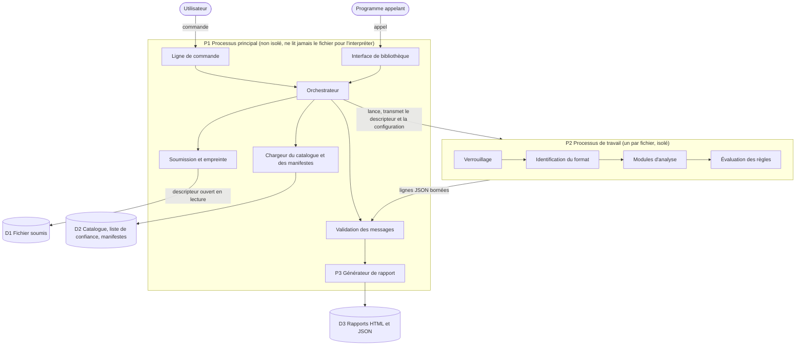
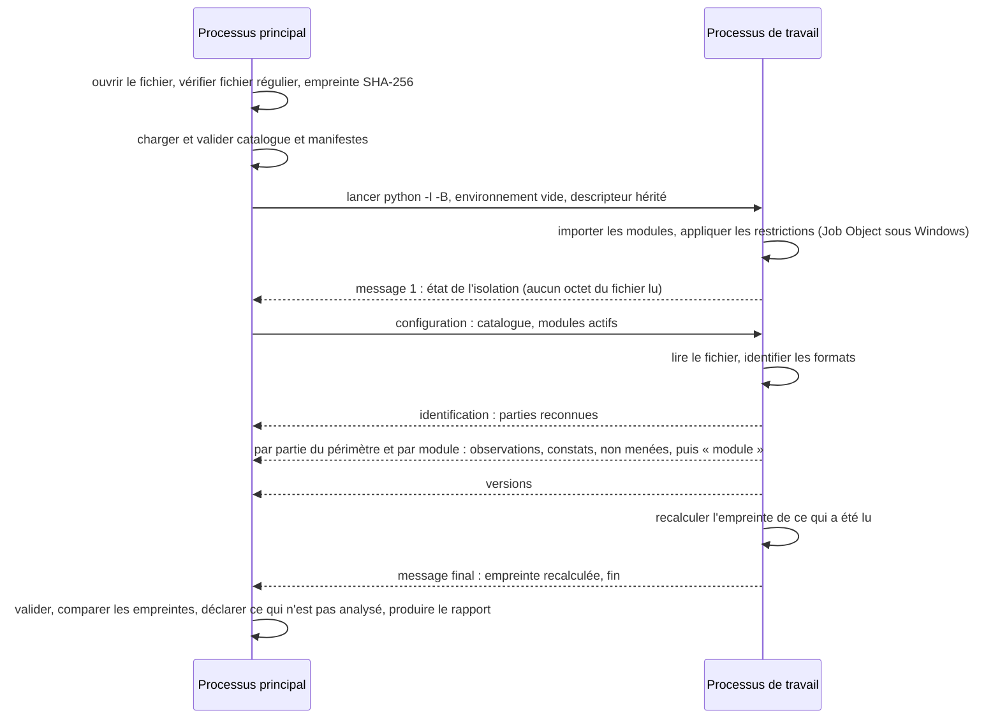

# Architecture

> Statut : **v1.12** ; v1.0 mergée avec T04, v1.1 avec T10, v1.2 avec T11, v1.3 avec T12, v1.4 et v1.5 avec les compléments de T10, v1.6 avec T13, v1.7 avec T14, v1.8 avec T15, v1.9 avec T16, v1.10 avec T17, v1.11 avec T18, v1.12 proposée dans la PR de T20. Document vivant : toute modification est inscrite à l'historique (§13).
> Exigences : NF-01, NF-06, NF-10 ; exigences de sécurité ES-01, ES-02, ES-05, ES-10, ES-17, ES-18 du [modèle de menace](../modele-de-menace/modele-de-menace.md) ; constats A-05, A-16, A-30, A-53 de l'[analyse critique](../01-analyse/analyse-critique-cdc-v0.1.md).
> Tâche : T04. Date de rédaction : 2026-10-26.

## 1. Objet

Ce document décrit comment l'outil est construit : ses composants, le déroulé d'une analyse, l'isolation sur chaque système, les données échangées, les dépendances et la distribution. Il applique les décisions de T02 et les exigences de sécurité de T03 ; il ne décide rien par lui-même, chaque choix renvoie à un ADR.

Il fixe les **frontières et les contrats**, pas le détail : le modèle de données (T11), le moteur de modules (T12), les limites chiffrées (T14), le schéma du catalogue (T15) et le rapport (T16) restent à leurs tâches (§12).

### Décisions de T04

| ADR | Décision |
| --- | --- |
| [ADR-0034](../decisions/ADR-0034-langage-python.md) | Python 3.12 ou ultérieur |
| [ADR-0035](../decisions/ADR-0035-systemes-et-mecanismes-d-isolation.md) | Linux, macOS et Windows en V1 ; Linux en référence ; mécanismes d'isolation par système |
| [ADR-0036](../decisions/ADR-0036-processus-de-travail-et-protocole.md) | Un interpréteur neuf par fichier, fichier transmis par descripteur, résultats en lignes JSON validées |
| [ADR-0037](../decisions/ADR-0037-gestion-des-dependances.md) | uv, verrou à empreintes, fichier d'installation verrouillé publié |
| [ADR-0038](../decisions/ADR-0038-format-du-catalogue.md) | Catalogue en TOML, validé par JSON Schema |
| [ADR-0039](../decisions/ADR-0039-expressions-regulieres-re2.md) | Expressions régulières du catalogue exécutées par RE2 |
| [ADR-0040](../decisions/ADR-0040-empreinte-sha-256.md) | Empreinte SHA-256 du fichier entier |
| [ADR-0041](../decisions/ADR-0041-canal-de-distribution.md) | Canal unique PyPI, Trusted Publishing et attestations |
| [ADR-0042](../decisions/ADR-0042-modules-et-extension.md) | Modules découverts dans le paquet, manifeste déclaratif, aucune extension tierce en V1 |
| [ADR-0043](../decisions/ADR-0043-politique-des-bibliotheques.md) | Analyseurs de structure en Python pur ; bibliothèques tierces choisies par critères |
| [ADR-0044](../decisions/ADR-0044-titre-des-commits-de-merge.md) | Titre des commits de merge fixé à la main (méthode) |

## 2. Vue d'ensemble



Description textuelle (accessibilité, ADR-0025) :

- L'utilisateur passe par la **ligne de commande**, un programme par l'**interface de bibliothèque** ; les deux mènent à l'**orchestrateur**, dans le processus principal P1.
- P1 ouvre le fichier, vérifie que c'est un fichier régulier, calcule son empreinte, charge et valide le catalogue et les manifestes des modules. Il n'interprète jamais le contenu du fichier.
- Pour chaque fichier, P1 lance un **processus de travail** P2. P2 se verrouille, identifie le format, exécute les modules qui le traitent, évalue les règles du catalogue, et renvoie ses résultats en lignes JSON.
- P1 valide chaque message par schéma, puis le **générateur de rapport** produit les exports HTML et JSON.

Ce découpage reprend le diagramme de flux du modèle de menace (§5) : P1, P2, P3 et les frontières FC1 (fichier vers P2) et FC2 (P2 vers P1) y gardent le même sens.

## 3. Déroulé d'une analyse



Description textuelle :

1. P1 ouvre le fichier en lecture seule et sans blocage, vérifie sur le descripteur que c'est un fichier régulier (ES-08), calcule l'empreinte SHA-256 (ADR-0040).
2. P1 charge le catalogue et la liste de confiance, les valide par schéma (ES-09), lit les manifestes des modules (ADR-0042).
3. P1 refuse un fichier de plus de 1 Gio avant de le lire (F-04, ADR-0077), puis lance P2 : `python -I -B -m voight_kampff._travail`, environnement vidé, seul le descripteur du fichier et les tubes hérités (ADR-0036, ADR-0065).
4. P2 importe ses modules, applique ses restrictions (§5), Job Object compris sous Windows (ADR-0081), puis envoie l'**état de l'isolation**. À ce moment, il n'a lu aucun octet du fichier : ce message est fiable.
5. P1 envoie la configuration : catalogue validé, modules actifs. Les limites n'y figurent pas : fixes, elles sont lues par les deux processus dans `_limites.py` (ADR-0077).
6. P2 lit le fichier par lectures à position explicite, identifie les formats et envoie les **parties** reconnues (ADR-0070, ADR-0071). Pour chaque partie du périmètre, il exécute les modules concernés dans l'ordre de la configuration, chacun lisant sa partie comme un fichier autonome, évalue les règles, et envoie les résultats de chaque module suivis de son message « module » (ADR-0062). Il recalcule enfin l'empreinte de ce qu'il a lu.
7. P1 valide chaque message ; une empreinte finale différente refuse le fichier ; si P2 n'a pas envoyé la sienne, P1 hache de nouveau (ES-08, ADR-0075). Un message invalide, un délai dépassé, la mémoire épuisée ou un arrêt anormal donnent des analyses non menées (ES-04, NF-03) ; sous macOS, P1 surveille la mémoire de P2 pendant l'attente (ADR-0080). P1 déclare non menées les parties hors périmètre ou tronquées et les plages non reconnues (ADR-0071). P1 rend une analyse, qui porte les règles que citent ses constats (ADR-0073, ADR-0097). P3, dans le processus principal, en tire le rapport et l'exporte en HTML et en JSON, données identifiantes masquées par défaut ; la commande affiche un résumé et écrit les rapports demandés par `--rapport` (ADR-0092 à ADR-0098).

Dans un lot (ADR-0015), ces étapes se répètent pour chaque fichier, avec un nouveau P2, sans état partagé (ES-04).

## 4. Composants et organisation du code

Le paquet d'import s'appelle `voight_kampff` ; il est publié sur PyPI sous le nom `voight-kampff-forensics` et installe les commandes `voight-kampff` et `vk` ([ADR-0045](../decisions/ADR-0045-nom-du-projet.md)). T10 a créé `__init__.py`, `__main__.py`, `cli.py` et `py.typed` ; T11 a créé `rapport/modele.py` et `schemas/` (schémas du rapport et des messages) ; T12 a créé `_protocole.py`, `_orchestration/`, `_travail/`, `modules/` (vide) et le schéma des manifestes ; T13 a créé `formats.py`, `analyse.py`, `_orchestration/soumission.py` et `_travail/identification.py` ; T14 a créé `_limites.py`, `_orchestration/surveillance.py` et `_travail/restrictions/` ; T15 a créé `_regles.py`, `_orchestration/catalogue.py`, `donnees/catalogue/` et `modules/hors_v1.toml` ; T16 a créé `rapport/export.py` (exports et masquage), `rapport/_html.py` (document HTML), `rapport/_presentation.py` (textes, valeurs, résumé) et `rapport/textes.toml` (textes du rapport) ; T18 a créé `rapport/comparaison.py` (comparaison de deux rapports, `vk --comparer`, ADR-0112) ; T20 a créé les modules `modules/exif/`, `modules/xmp/`, `modules/iptc/`, `modules/textepng/` et leurs lecteurs communs `modules/_lecture/` (ADR-0114) ; les autres éléments arrivent avec leurs tâches.

Hors du paquet, à la racine du dépôt, T17 a créé `banc/` : le banc d'évaluation et la matrice de vérification, outils de développement qui ne sont ni dans le wheel ni dans le paquet source ([ADR-0099](../decisions/ADR-0099-banc-outil-du-depot.md)). Le banc analyse un corpus par l'interface publique, dans un espace de noms réseau vide (ADR-0100), et mesure les taux du §8 du cahier (ADR-0104) ; la matrice relie chaque exigence à sa vérification (ADR-0102). T18 y ajoute la double analyse de chaque fichier (ADR-0113).

```text
src/voight_kampff/
  __init__.py        interface publique de la bibliothèque : analyse par P2 seulement (ES-17)
  __main__.py        lancement par python -m voight_kampff
  analyse.py         analyser(), Analyse, AnalyseRefusee : interface publique (ADR-0073)
  cli.py             ligne de commande (argparse) : vk FICHIER... --desactiver MODULE
  formats.py         vocabulaire des formats et extensions (P1, P2, modèle ; ADR-0070)
  _limites.py        valeurs des limites, fixes (P1 et P2 ; ADR-0077, ADR-0078)
  _protocole.py      lignes JSON du protocole, décodage strict (P1 et P2)
  _orchestration/    P1 : manifestes, lancement de P2, délai, validation des messages ; soumission, empreinte, refus (T13) ; surveillance de la mémoire sous macOS (T14) ; chargement du catalogue (T15)
  _travail/          point d'entrée de P2 : verrouillage, garde, identification, contexte et budget des modules, acheminement
  _travail/restrictions/  restrictions par système : linux, macos, windows (ADR-0079 à ADR-0081)
  _regles.py         règles du catalogue : forme, motifs RE2, évaluation (P1 et P2 ; ADR-0084, ADR-0089)
  modules/           une technique par sous-paquet, avec son manifeste (ADR-0042) ; techniques hors V1 (hors_v1.toml, ADR-0087)
  modules/_lecture/  lecteurs de structure communs aux modules de métadonnées, sans manifeste (T20, ADR-0114)
  rapport/           modèle du rapport (T11) ; exports HTML et JSON, masquage, textes du rapport (T16) ; comparaison (T18)
  schemas/           JSON Schema : messages de P2, catalogue et règles, manifestes, techniques hors V1, rapport
  donnees/           catalogue TOML (T15, ADR-0088) ; liste de confiance C2PA (T30)
```

| Composant | Processus | Rôle | Tâches |
| --- | --- | --- | --- |
| Ligne de commande, interface de bibliothèque | P1 | Entrées ; aucune fonction d'analyse dans le processus appelant | T10, T12, T13, T90 |
| Orchestration | P1 | Ouverture, empreinte, lancement, délais, validation, lot, refus | T12, T13, T14 |
| Identification | P2 | Formats reconnus, leurs plages et leur fin logique (ADR-0070) | T13 |
| Isolation | P2 (P1 pour la mémoire sous macOS) | Restrictions du système, état de l'isolation | T14 |
| Travail | P2 | Verrouillage, protocole, acheminement, isolation des erreurs par module | T12 |
| Catalogue | P1 | Lecture, validation, empreinte, cohérence avec les manifestes | T15 |
| Règles | P1 (forme, compilation), P2 (évaluation) | Application du catalogue aux observations | T15 |
| Modules | P2 | Une technique chacun | T13, T20 et suivantes |
| Rapport | P1 | Résumé sans verdict, rubriques, masquage, neutralisation, exports (ADR-0093 à ADR-0098) | T11, T16 |
| Schémas, données | P1 et P2 | Contrats et catalogue livrés avec l'outil | T11, T15, T30 |

Les dossiers préfixés `_` sont internes ; les analyseurs vérifient qu'ils s'exécutent dans un P2 verrouillé et refusent sinon (ES-17).

## 5. Isolation par système

Restrictions appliquées par P2 à lui-même, avant de lire le fichier ([ADR-0035](../decisions/ADR-0035-systemes-et-mecanismes-d-isolation.md)), réalisées en T14 ([ADR-0079](../decisions/ADR-0079-restrictions-sous-linux.md), [ADR-0080](../decisions/ADR-0080-restrictions-sous-macos.md), [ADR-0081](../decisions/ADR-0081-restrictions-sous-windows.md)) et vérifiées depuis un module par la CI des trois systèmes (ADR-0083) :

| Restriction (ES-02, ES-03, ES-15) | Linux (référence) | macOS | Windows |
| --- | --- | --- | --- |
| Réseau | seccomp : création de socket refusée ; Landlock : TCP (ABI 4) | Seatbelt : connexion refusée (la création d'une socket reste permise) | Non bloqué : « isolation réduite » |
| Système de fichiers | Landlock sans règle : aucun accès ; fichier par descripteur | Seatbelt : aucune écriture ; lecture limitée à Python et au paquet | Intégrité « basse » : écriture refusée presque partout ; lecture non restreinte |
| Nouveaux programmes | seccomp : `execve`, `execveat` refusés ; `no_new_privs` | Seatbelt : refusé | Job Object : un seul processus |
| Autres processus | seccomp : `ptrace`, `process_vm_*` ; Landlock : signaux (ABI 6) | Seatbelt | Job Object : bureau, presse-papiers |
| Mémoire (2 Gio) | `RLIMIT_AS` | Surveillance par P1 (`proc_pid_rusage`) | Job Object |
| Temps (120 s) | `RLIMIT_CPU` et délai de P1 | `RLIMIT_CPU` et délai de P1 | Job Object et délai de P1 |
| Vidages mémoire | `RLIMIT_CORE` nul, non vidable | `RLIMIT_CORE` nul | Non garantis : déclarés manquants |
| Ce qui peut manquer | Landlock absent ou ABI 1-2 ; architecture autre que x86-64 et AArch64 | Interface Seatbelt retirée par Apple | Toujours : réseau, lecture, vidages |

Le rapport porte l'état de l'isolation : complète, ou réduite avec la liste de ce qui manque. Un conteneur reste l'option documentée pour les profils exposés (ADR-0028).

Ce qui ne passe par aucun de ces mécanismes, sur tous les systèmes :

- le XML est lu par expat, DOCTYPE et entités refusés ([ADR-0116](../decisions/ADR-0116-xml-par-expat-sans-dtd.md)), les archives en mémoire, jamais extraites (ES-05) ;
- aucune URL issue du fichier n'est résolue (ES-06, ADR-0033) ;
- P2 n'écrit rien sur disque ; ES-02 autorise un répertoire temporaire privé, la V1 n'en prévoit pas.

## 6. Contrats de données

| Échange | Forme | Validation |
| --- | --- | --- |
| P1 → P2, configuration | Un objet JSON sur l'entrée standard, envoyé après le message d'isolation : modules actifs dans l'ordre d'exécution (identifiant, formats, directions) ; règles du catalogue qui relèvent d'eux (T15, ADR-0084) ; les limites n'y passent pas (ADR-0077) | Données produites par P1 ; forme vérifiée par P2 (ADR-0065) |
| P2 → P1, résultats | Lignes JSON sur la sortie standard, de types : `isolation`, `identification`, `observation`, `constat`, `non_menee`, `module`, `versions`, `fin` | Taille bornée par message et au total ; JSON strict, JSON Schema par type, modèle, ordre du protocole (ES-04, ADR-0062, ADR-0065) |
| P2 → P1, erreurs | Sortie d'erreur, où part aussi tout texte affiché par un module | Envoyée vers le néant : jamais lue, affichée ni recopiée (ES-15, ADR-0065) |
| Catalogue, manifestes | TOML | JSON Schema au chargement (ES-09, ADR-0038) |
| Rapport exporté | JSON et HTML autonome | Schéma publié (ADR-0025) ; HTML échappé, politique de sécurité du contenu (ES-12) |

Une **observation** est une donnée relevée par un module (valeur d'un champ, mesure). Un **constat** est ce qu'une règle du catalogue en tire : phrase, donnée observée, règle, catégorie, direction, niveau (§6 du cahier, ADR-0018, ADR-0021). Cette séparation garde les règles hors du moteur (F-26) ; un module peut aussi produire un constat directement quand la vérification est déterministe (signature C2PA), en citant une règle « module » du catalogue, qui fixe ce que dit le constat ; le principal vérifie que chaque constat reçu est conforme à sa règle (ADR-0084, ADR-0090). La forme exacte est fixée par le [modèle de données](../modele-de-donnees/modele-de-donnees.md) (T11, ADR-0058).

Les règles sont évaluées dans P2 : une donnée hostile n'est jamais confrontée à une expression régulière **du catalogue** dans P1. Les schémas des messages emploient seulement des expressions fixes, ancrées et linéaires, bornées en longueur (ADR-0054). Conséquence acceptée : un P2 compromis peut forger les constats de son propre fichier (RR-01).

## 7. Modules et extension (NF-10)

- Un module est un sous-paquet de `modules/`, avec un manifeste TOML : identifiant, version, formats, exigences, règles employées, fiche technique, dépendances envers d'autres modules, bibliothèques qui lisent le fichier ([ADR-0042](../decisions/ADR-0042-modules-et-extension.md), [ADR-0120](../decisions/ADR-0120-bibliotheques-au-manifeste.md)). Les fiches sont dans [`docs/techniques/`](../techniques/README.md).
- P1 lit les manifestes sans importer le code, et en tire la couverture du rapport (F-25, F-82). P2 importe le code.
- Ajouter une technique ou un format, c'est ajouter un sous-paquet, ses règles au catalogue et sa fiche : aucun autre module n'est modifié.
- Un module expose `analyser(contexte)` ; le contexte lit le fichier par position et reçoit observations, constats et analyses non menées ([ADR-0061](../decisions/ADR-0061-interface-d-un-module.md)). Le manifeste est validé par schéma ; un module s'exécute après ceux qu'il requiert ([ADR-0064](../decisions/ADR-0064-manifeste-des-modules.md)).
- Une exception dans un module rend ses analyses « non menées » et ses résultats sont écartés ([ADR-0060](../decisions/ADR-0060-resultats-d-un-module-en-erreur.md)) ; un arrêt de P2 rend non menées toutes les analyses restantes du fichier, avec la raison ([ADR-0062](../decisions/ADR-0062-message-de-fin-de-module.md)).
- Un module désactivé, ou qui en requiert un désactivé, n'est pas exécuté ; `voight-kampff --modules` liste les modules livrés ([ADR-0063](../decisions/ADR-0063-desactivation-et-liste-des-modules.md)).
- Le contenu extrait d'un fichier (images et texte d'un PDF, T53) est acheminé vers les modules concernés dans le même P2.
- Point d'extension des services tiers (ADR-0017) : interface documentée, aucune implémentation en V1 ; un tel service ne peut pas s'exécuter dans P2, qui n'a pas de réseau. Son mode d'exécution sera fixé par un nouvel ADR, avec révision du modèle de menace.

## 8. Catalogue et règles

- Fichiers TOML livrés dans le paquet (`donnees/catalogue/` : `catalogue.toml`, `regles/<module>.toml`), validés par JSON Schema au chargement ; version, date et empreinte SHA-256 au rapport ; catalogue fourni par l'utilisateur accepté, en remplacement complet, et signalé (ADR-0029, ADR-0038, ADR-0040, ADR-0086, ADR-0088).
- Règles « moteur » (conditions fermées, toutes requises) et règles « module » (appliquées par le code du module) ; la règle fixe gabarit, catégorie, direction, fondement, niveau (ADR-0084, ADR-0090).
- Expressions régulières exécutées par RE2, compilées par P1 au chargement pour valider le catalogue, appliquées par P2 après chaque module (ADR-0039, ADR-0089).
- Seuils, procédure de calibrage, niveau, évaluation et limites connues de chaque règle dans le catalogue (ADR-0016, ADR-0018, ADR-0019).
- Version propre au catalogue, registre des versions vérifié par les tests et la CI (ADR-0085) ; guide et procédure de mise à jour : [`docs/catalogue/`](../catalogue/README.md).
- Les techniques hors V1 ne sont pas dans le catalogue : `modules/hors_v1.toml`, livré avec l'outil (ADR-0087).

## 9. Dépendances

Politique : [ADR-0043](../decisions/ADR-0043-politique-des-bibliotheques.md) ; gestion : [ADR-0037](../decisions/ADR-0037-gestion-des-dependances.md).

| Dépendance | Licence | Où elle s'exécute | Pourquoi |
| --- | --- | --- | --- |
| Bibliothèque standard Python | PSF-2.0 | P1 et P2 | `hashlib`, `tomllib`, `json`, `zipfile`, `struct`, `argparse`, `ctypes` ; expat (`xml.parsers.expat`) pour XMP depuis T20 (ADR-0116), version au rapport (ADR-0120) |
| `c2pa-python` | Apache-2.0 ou MIT | P2 | C2PA (T30) |
| ~~`defusedxml`~~ | PSF-2.0 | — | Écartée en T20 au profit d'expat, DTD refusée (ADR-0116) |
| `pypdf` | BSD-3-Clause | P2 | Objets PDF (T50 à T53) |
| `google-re2` | BSD-3-Clause | P1 (compilation), P2 | Expressions du catalogue (ES-09) ; dépendance depuis T15 (ADR-0039, ADR-0089) |
| `jsonschema` | MIT | P1 | Validation des messages, du catalogue, des manifestes ; dépendance depuis T11 (ADR-0054) |
| `numpy` | BSD-3-Clause | P2 | Analyses JPEG (T40, T41) |
| uv | Apache-2.0 ou MIT | Développement, CI | Verrou à empreintes |
| exiftool | Perl (Artistic ou GPL) | Tests seulement | Oracle de test des métadonnées (T20, T21) : sortie enregistrée avec les échantillons, relancé s'il est installé (ADR-0122) |

Cette liste est une liste de candidates : chaque tâche confirme ou remplace la sienne selon les critères d'ADR-0043. Exclues : GPL et AGPL, lecteurs qui résolvent des entités externes ou suivent des liens.

### Examen de T10

Fait le 2026-10-26 à partir des métadonnées publiées sur PyPI. Aucune de ces bibliothèques n'était alors une dépendance : chacune est ajoutée par sa tâche (ADR-0043), qui refait la vérification à la version retenue. `jsonschema` l'a été en T11 (ADR-0054).

| Bibliothèque | Version examinée | Paquets précompilés | Dépendances transitives | Points relevés |
| --- | --- | --- | --- | --- |
| `google-re2` | 1.1.20251105 (nov. 2025) | Python 3.10 à 3.14, Linux, macOS, Windows ; pas de 3.15 | Aucune | 3.15 non pris en charge : matrice limitée à 3.14 (ADR-0051). Licence déclarée par classificateur seulement (BSD) |
| `c2pa-python` | 0.38.1 (2026-10-22) | Linux (x86_64, aarch64), macOS (x86_64, arm64) ; **pas de Windows** dans cette version, présent jusqu'à 0.38.0 ; pas de paquet source | `cryptography` (Rust et OpenSSL, par `cffi` et `pycparser`), `requests` (avec `urllib3`, `idna`, `charset-normalizer`, `certifi`), `toml` | `requests` est une bibliothèque réseau : critère « aucun accès réseau, ou désactivable » à vérifier en T30 (P2 n'a de toute façon pas de réseau). `toml` n'a plus de version depuis 2020 (critère « maintenue »). `certifi` est sous MPL-2.0, copyleft faible par fichier, compatible avec une diffusion sous Apache-2.0 tant qu'il n'est pas modifié |
| `jsonschema` | 4.26.0 | Python pur | `attrs`, `jsonschema-specifications`, `referencing`, `rpds-py` | `rpds-py` est écrit en Rust (sûr pour la mémoire), paquets pour les trois systèmes ; s'exécute dans P1. Toutes MIT |
| `numpy` | 2.5.4 | Python 3.12 à 3.15, trois systèmes | Aucune | Licence composée, toutes permissives (BSD-3-Clause, 0BSD, MIT, Zlib, CC0-1.0) |
| `pypdf` | 6.21.2 | Python pur | Aucune obligatoire | Les PDF chiffrés demandent l'option `crypto` (`cryptography`) : à trancher en T50 |
| `defusedxml` | 0.7.1 (mars 2021) | Python pur | Aucune | Plus de version depuis 2021 (critère « maintenue ») ; T20 compare avec les protections actuelles de la bibliothèque standard (fait : écartée, ADR-0116) |

Outillage de développement verrouillé en T10 (41 paquets dans `uv.lock`, avec empreintes) : Ruff 0.17.2, mypy 2.4.0, pytest 9.1.1, coverage.py 7.17.0, pip-audit 2.10.1 et leurs dépendances ; pip-audit n'y signale aucune faille connue. Outil de construction : `uv_build` 0.13.5, épinglé avec empreintes (ADR-0049).

## 10. Reproductibilité (NF-06)

Reformulée par ADR-0023 : mêmes fichier, versions de l'outil, du catalogue et des dépendances, mêmes données externes, analyse non interrompue.

| Condition | Moyen |
| --- | --- |
| Mêmes versions de l'outil et des dépendances | Verrou `uv.lock` ; fichier d'installation verrouillé publié avec chaque version (ADR-0037) ; versions réelles au rapport |
| Même catalogue | Livré avec l'outil, version et empreinte au rapport (ADR-0029) |
| Mêmes données externes | Hors ligne par défaut (ADR-0010) ; toute réponse réseau inscrite au rapport (ADR-0033) |
| Analyse non interrompue | Budget mixte (ADR-0076) : limites comptées par le moteur, identiques partout ; mémoire et temps du système, garde-fous dont le dépassement interrompt l'analyse, signalée et hors garantie (ADR-0078) |
| Aucun état partagé | Un interpréteur neuf par fichier (ADR-0036) |

## 11. Distribution et chaîne d'approvisionnement

- Canal officiel unique : PyPI, publication par Trusted Publishing avec attestations de provenance ; release GitHub avec empreintes des paquets, fichier d'installation verrouillé, version et empreinte du catalogue ([ADR-0041](../decisions/ADR-0041-canal-de-distribution.md)).
- Installation documentée par `pipx` ou `uv tool` ; installation reproductible par le fichier verrouillé.
- Actions d'intégration continue épinglées par empreinte de commit (ADR-0006) ; dépendances figées avec empreintes (ADR-0037) ; peu de dépendances (ADR-0043).
- Workflow de publication (T10) : déclenché par une étiquette `vX.Y.Z` égale à la version du paquet (ADR-0050) ; construction épinglée (ADR-0049) ; publication depuis l'environnement protégé « pypi », relecture de TheDarkMac obligatoire ; release GitHub avec paquets, empreintes et fichier d'installation verrouillé. L'étiquette doit être posée sur un commit de l'historique de premier parent de `detector`, la version être publique au sens de PEP 440 ; une pré-version donne une release marquée comme telle ([ADR-0069](../decisions/ADR-0069-controles-de-la-publication.md)). Numérotation : [ADR-0068](../decisions/ADR-0068-numerotation-des-versions.md). La version, la date et l'empreinte du catalogue, recalculées depuis le wheel et contrôlées contre le registre, sont jointes à la release (`CATALOGUE.txt`, ADR-0085).
- Fichier `LICENSE` (Apache-2.0, tout le dépôt) livré dans les deux paquets, licence déclarée par expression SPDX ([ADR-0067](../decisions/ADR-0067-fichier-licence-et-declaration.md)) ; éditeur de confiance « en attente » déclaré sur PyPI. Prérequis réunis : la première publication, par une étiquette de version, réservera le nom.

### Réalisation des exigences de sécurité rattachées à T04

| ES | Ce que l'architecture prévoit | Réalisée en |
| --- | --- | --- |
| ES-01 | Un P2 par fichier ; P1 ne lit le fichier que pour l'empreinte (§3) | T12 (lancement) ; T13 (ouverture et empreinte, ADR-0075) |
| ES-02 | Restrictions par système, état de l'isolation au rapport (§5) | T14 (ADR-0079 à ADR-0081) |
| ES-05 | expat, DOCTYPE et entités refusés (ADR-0116) ; archives en mémoire ; aucune écriture de P2 (§5) | T20 (XMP), T21 |
| ES-10 | P2 sans réseau ; toute requête sortante part de P1, désactivée par défaut, selon ADR-0033 ; inventaire du modèle de menace inchangé | T30 |
| ES-17 | Interface publique limitée à l'analyse par P2 ; garde dans les analyseurs (§4) | T12 (garde, ADR-0061) ; T13 (`analyser`, ADR-0073) |
| ES-18 | Verrou à empreintes, canal unique, attestations, peu de dépendances, Python pur d'abord (§9, §11) | T10 |

Les autres exigences (ES-03, ES-04, ES-06 à ES-09, ES-11 à ES-16, ES-19 à ES-22) sont réalisées par les tâches que le modèle de menace leur attribue ; l'architecture leur donne leur place : limites dans P2 (ES-03), messages validés (ES-04), empreinte recalculée (ES-08), catalogue validé (ES-09), rapport dans P1 (ES-12 à ES-14), aucune écriture (ES-15).

## 12. Ce que l'architecture ne fixe pas

| Point | Tâche |
| --- | --- |
| ~~Valeurs des limites, délai, budget de travail ; mesure du coût de démarrage de P2~~ | Fixés en T14 : ADR-0076 à ADR-0078 ; 0,35 s par fichier |
| ~~Points « à confirmer » de l'isolation sous macOS et Windows~~ | Tranchés en T14 : ADR-0080, ADR-0081 |
| ~~Forme des observations, des constats et des messages~~ | Fixée en T11 : [modèle de données](../modele-de-donnees/modele-de-donnees.md) |
| ~~Schéma et découpage du catalogue ; syntaxe RE2 admise~~ | Fixés en T15 : ADR-0084, ADR-0088, ADR-0089 |
| ~~Gabarit HTML et moyen d'échappement~~ | Fixés en T16 : ADR-0094, ADR-0096 |
| Paquets binaires de `c2pa-python` sous Windows ; `requests` et `toml` parmi ses dépendances (§9) | T30 |
| ~~Maintenance de `defusedxml` (dernière version en 2021) (§9)~~ | Tranché en T20 : écartée, ADR-0116 |
| Python 3.15, dès que `google-re2` le prend en charge (ADR-0051) | Nouvelle PR |
| Moyen de lire les coefficients DCT | T41 |
| Mode d'exécution d'un service tiers | Nouvel ADR, avec le premier service |
| ~~Identification du format et sa transmission à P1 ; comparaison des empreintes ; interface publique `analyser`~~ | Fixés en T13 : ADR-0070 à ADR-0075 |
| ~~Refus d'un fichier « hors limites » (F-04)~~ | Fixé en T14 : ADR-0077 |
| ~~Rapport construit à partir d'une analyse, exports, masquage ; résumé du terminal revu~~ | Fixés en T16 : ADR-0092 à ADR-0098 |
| Visualisation intégrée au rapport HTML (F-84) : image `data:` et politique `img-src` | Première technique qui en produit une, nouvel ADR (ADR-0094) |
| Saisie de texte collé (A-29) | T80 (ADR-0074) |
| ~~Job Object sous Windows, lanceur de l'environnement virtuel compris ; valeurs des tailles et du délai, provisoires en T12 (ADR-0065)~~ | Fixés en T14 : ADR-0077, ADR-0081 |
| ~~Coût de la validation des messages par P1 (environ 1,5 ms par message, compté dans le délai de 120 s)~~ | Fixé en T20 : 1,6 à 3,5 ms mesurées, quatre à cinq fois moins après résolution des références ; 4 096 résultats par module et par partie (ADR-0121) |
| Conteneur d'application (AppContainer) sous Windows, pour bloquer réseau et lecture | Nouvel ADR (ADR-0035, ADR-0081) |
| ~~Versions des bibliothèques employées par un module, lues avant le verrouillage (ADR-0064)~~ | Fixé en T20 : champ `bibliotheques` du manifeste (ADR-0120) |
| ~~Liste des techniques hors V1 par format (`hors_v1`)~~ | Fixée en T15 : ADR-0087 |
| Règle qui compare deux observations (F-13, incohérences de dates) | T23, nouveau format du catalogue ou règle « module » (ADR-0084) |
| Marquages recherchés (F-25) inscrits au catalogue | T31 |
| Acheminement des résultats d'un module vers un autre ; constat qui cite les observations d'un autre module (ADR-0061) | T53 |

## 13. Historique

| Date | Version | Modification | Origine |
| --- | --- | --- | --- |
| 2026-10-26 | 1.0 | Création | T04 |
| 2026-10-26 | 1.1 | Nom du paquet `voight_kampff` (§3, §4, ADR-0045) ; examen des dépendances candidates (§9) ; workflow de publication (§11) ; points transmis à T20, T30 (§12) | T10 |
| 2026-10-26 | 1.2 | Modèle de données : `rapport/modele.py` et `schemas/` (§4), renvoi et précision sur les expressions dans P1 (§6), `jsonschema` ajouté (§9), point de T11 fixé (§12) | T11 |
| 2026-10-26 | 1.3 | Moteur de modules : commande `-I -B` et message « module » (§3), fichiers créés (§4), configuration, messages et sortie d'erreur (§6), interface et règles des modules (§7), ES-01 et ES-17 (§11), points transmis à T13, T14, T15, T53 (§12) | T12 |
| 2026-10-27 | 1.4 | Licence livrée dans les paquets et éditeur de confiance PyPI déclaré (§11, ADR-0067) | T10 (complément) |
| 2026-10-27 | 1.5 | Contrôles de la publication et numérotation des versions (§11, ADR-0068, ADR-0069) | T10 (complément) |
| 2026-10-27 | 1.6 | Soumission et identification : déroulé (§3), fichiers créés et composant Identification (§4), message `identification` (§6), ES-01 et ES-17 (§11), points fixés et transmis à T14, T16, T80 (§12) | T13 |
| 2026-10-27 | 1.7 | Sécurité d'exécution : refus hors limites et Job Object (§3), fichiers créés, restrictions dans `_travail/restrictions/` au lieu de `_isolation/` (§4), isolation réalisée et mesurée (§5), limites hors de la configuration (§6), budget mixte (§10), ES-02 (§11), points fixés et transmis à T20 (§12) | T14 |
| 2026-10-27 | 1.8 | Catalogue de règles : fichiers créés et composants Catalogue et Règles (§4), règles dans la configuration et constats conformes à leur règle (§6), catalogue et règles (§8), `google-re2` ajouté (§9), catalogue joint à la release (§11), points fixés et transmis à T23, T31 (§12) | T15 |
| 2026-10-28 | 1.9 | Génération du rapport : déroulé (§3), fichiers créés et composant Rapport (§4), points fixés et visualisation transmise à sa technique (§12) | T16 |
| 2026-10-28 | 1.10 | Banc d'évaluation et matrice de vérification, hors du paquet (§4) | T17 |
| 2026-10-28 | 1.11 | Reproductibilité : `rapport/comparaison.py` et double analyse du banc (§4) | T18 |
| 2026-10-28 | 1.12 | Premiers modules : métadonnées d'image et lecteurs communs (§4), XML par expat (§5, §9, §11), bibliothèques au manifeste (§7), `defusedxml` écarté et oracle exiftool (§9), points tranchés (§12) | T20 |
