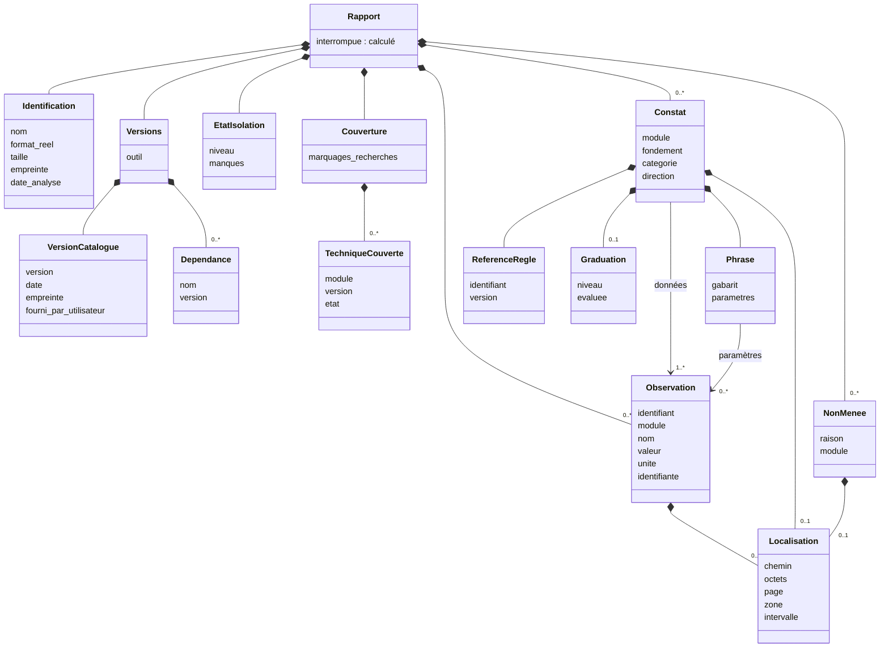

# Modèle de données

> Statut : **v1.0**, proposée dans la PR de T11. Document vivant : toute modification est inscrite à l'historique (§10).
> Exigences : F-80, F-81, F-82, §6 du cahier ; ES-04, ES-20 du [modèle de menace](../modele-de-menace/modele-de-menace.md) ; constats A-02, A-03, A-10, A-23, A-46, A-47 de l'[analyse critique](../01-analyse/analyse-critique-cdc-v0.1.md).
> Tâche : T11. Date de rédaction : 2026-10-26.

## 1. Objet

Ce document décrit les données qu'une analyse produit : observations, constats, analyses non menées, couverture, et le rapport qui les réunit. Il fixe aussi les messages que le processus de travail envoie au processus principal. Chaque choix renvoie à un ADR ; le vocabulaire est défini dans le [glossaire](../glossaire.md).

### Décisions de T11

| ADR | Décision |
| --- | --- |
| [ADR-0054](../decisions/ADR-0054-representation-du-modele.md) | Dataclasses figées et JSON Schema écrits à la main, validés par `jsonschema` |
| [ADR-0055](../decisions/ADR-0055-cinq-directions.md) | Cinq directions : « transformation » ajoutée à F-81 |
| [ADR-0056](../decisions/ADR-0056-raisons-des-analyses-non-menees.md) | Raisons des analyses non menées en liste fermée, phrase par gabarit |
| [ADR-0057](../decisions/ADR-0057-marquage-des-donnees-identifiantes.md) | Données identifiantes marquées par l'observation |
| [ADR-0058](../decisions/ADR-0058-observation-et-constat.md) | Structure de l'observation et du constat (proposé) |
| [ADR-0059](../decisions/ADR-0059-rapport-et-couverture.md) | Structure du rapport et de la couverture (proposé) |

### Où se trouve le code

| Élément | Fichier |
| --- | --- |
| Modèle (bibliothèque standard seulement) | `src/voight_kampff/rapport/modele.py` |
| Schéma du rapport | `src/voight_kampff/schemas/rapport.schema.json` |
| Schéma des messages | `src/voight_kampff/schemas/messages.schema.json` |
| Chargement et validation | `src/voight_kampff/schemas/__init__.py` |
| Tests | `tests/test_modele.py`, `tests/test_schemas.py` |

Version commune : `0.1.0` (`VERSION_SCHEMA`).

## 2. Vue d'ensemble



Description textuelle (accessibilité, ADR-0025) :

- Un **rapport** porte sur un seul fichier. Il contient une **identification**, des **versions** (outil, catalogue, dépendances), l'**état de l'isolation**, une **couverture** (techniques et marquages recherchés), et trois listes : **observations**, **constats**, **analyses non menées**.
- Un **constat** renvoie à une ou plusieurs observations (ses données) ; sa **phrase** est un gabarit dont chaque paramètre renvoie aussi à une de ces observations. Il cite sa **règle** (identifiant et version) et, s'il s'agit d'un indice, sa **graduation**.
- Une observation, un constat ou une analyse non menée peuvent porter une **localisation** dans le fichier.

## 3. Observation

Donnée relevée par un module : valeur d'un champ ou mesure, sans interprétation. C'est le **seul** objet qui porte des valeurs tirées du fichier ; c'est donc là, et seulement là, que s'appliquent l'échappement (ES-12) et le masquage (ES-13).

| Champ | Type | Obligatoire | Règle |
| --- | --- | --- | --- |
| `identifiant` | Identifiant | Oui | Unique dans le rapport ; forme conseillée `<module>/<n>` |
| `module` | Identifiant | Oui | Technique qui a relevé la donnée |
| `nom` | Identifiant | Oui | Vocabulaire du module, par exemple `exif.ifd0.Make` ; documenté dans sa fiche |
| `valeur` | Texte, nombre, booléen, ou liste d'au plus 4 096 de ceux-ci | Oui | Texte d'au plus 4 096 caractères, encodable en UTF-8 ; nombre fini, entre −2⁶³ et 2⁶³ − 1 |
| `unite` | Texte de 1 à 32 caractères | Non | `px`, `s`, `ratio`… |
| `localisation` | Localisation | Non | §6 |
| `identifiante` | Catégorie | Non | `metadonnee_nominative`, `numero_de_serie`, `gps`, `nom_de_fichier`, `empreinte` (ADR-0057) |

Une absence se dit aussi par une observation : « pas de bloc XMP » est l'observation `xmp.present` de valeur `false`.

## 4. Constat

Ce qu'une règle du catalogue tire d'une ou plusieurs observations (ADR-0058).

| Champ | Contenu | Obligatoire |
| --- | --- | --- |
| `phrase` | `gabarit` (identifiant) et `parametres` (nom → identifiant d'observation du constat, 32 au plus) | Oui |
| `donnees` | Identifiants d'observations, de 1 à 256, sans doublon | Oui |
| `regle` | `identifiant` et `version` de la règle du catalogue | Oui |
| `module` | Technique dont relève la règle | Oui |
| `fondement` | `verification_cryptographique`, `verification_deterministe`, `declaration`, `mesure` | Oui |
| `categorie` | `preuve`, `indice`, `information_neutre` (F-80) | Oui |
| `direction` | `origine_ia`, `retouche`, `transformation`, `authenticite`, `rien_de_particulier` (F-81, ADR-0055) | Oui |
| `graduation` | `niveau` (`faible`, `modere`, `fort`) et `evaluee` | Indice seulement |
| `localisation` | §6 | Non |

Combinaisons admises :

| Catégorie | Fondement | Direction | Graduation |
| --- | --- | --- | --- |
| Preuve | Vérification cryptographique ou déterministe (ES-20) | Toutes | Interdite |
| Indice | Tous | Toutes sauf « rien de particulier » | Obligatoire ; non évaluée ⇒ faible (ADR-0018) |
| Information neutre | Tous | « Rien de particulier » seulement | Interdite |

Les limites connues et le taux de la règle sont lus dans le catalogue (T15) ; la source d'une preuve est portée par ses observations (ADR-0058).

### Exemple : le constat du §6 du cahier

Le cahier donne : « Le fichier contient un manifeste C2PA valide qui déclare une génération par IA. Catégorie : preuve · Direction : origine IA · Règle : vérification C2PA (F-21) ». Selon ADR-0021, la preuve ne porte que sur ce que la vérification établit : le signataire reconnu a signé un manifeste qui déclare une génération par IA, et le contenu n'a pas changé depuis. La règle est une règle du catalogue, pas l'exigence F-21 (A-47). Identifiants de règle et de gabarit indicatifs, fixés en T15 et T30 :

```json
{
  "phrase": {
    "gabarit": "c2pa.manifeste-valide-generation-declaree",
    "parametres": { "signataire": "c2pa/2", "action": "c2pa/3" }
  },
  "donnees": ["c2pa/1", "c2pa/2", "c2pa/3"],
  "regle": { "identifiant": "R-C2PA-001", "version": "1" },
  "module": "c2pa",
  "fondement": "verification_cryptographique",
  "categorie": "preuve",
  "direction": "origine_ia",
  "localisation": { "chemin": "APP11/JUMBF/c2pa" }
}
```

Les observations `c2pa/1` à `c2pa/3` portent l'état de la signature, le signataire et l'action déclarée. Si le signataire est hors de la liste de confiance, la même vérification ne donne qu'un indice (ADR-0021).

## 5. Analyse non menée, couverture

**Analyse non menée** (ADR-0056) : `raison` (liste fermée), `module` (obligatoire pour les raisons propres à une technique), `localisation` facultative. La phrase affichée est le gabarit de la raison.

| Raison | Module obligatoire | Interrompt l'analyse |
| --- | --- | --- |
| `hors_v1`, `module_desactive`, `reference_manquante`, `reseau_desactive`, `erreur_module` | Oui | Non |
| `format_partiel`, `fichier_tronque` | Non | Non |
| `limite_depassee`, `delai_depasse`, `arret_processus`, `message_invalide` | Non | Oui |

**Couverture** (ADR-0059) : la liste des techniques, chacune avec sa version et son état (`appliquee`, `partielle`, `non_menee`, `non_applicable`), et les identifiants des marquages recherchés (F-25). Une technique hors de cette version de l'outil y figure sans version, à l'état non menée, avec la seule raison `hors_v1` (ADR-0012).

## 6. Localisation, identification, versions, isolation

**Localisation** (A-46), au moins un élément :

| Élément | Sens |
| --- | --- |
| `chemin` | Chemin dans la structure du format : segment JPEG, bloc PNG, objet PDF, propriété XMP |
| `octets` | Plage `debut`, `longueur` (≥ 1) dans le fichier |
| `page` | Page d'un PDF, ou rang d'une image dans un fichier qui en contient plusieurs, à partir de 1 |
| `zone` | Rectangle `x`, `y`, `largeur`, `hauteur` en pixels |
| `intervalle` | `debut` ≤ `fin`, en secondes, pour l'audio et la vidéo (hors V1, prévu par A-46) |

**Identification** : `nom` (sans `/`, `\` ni caractère nul : aucun chemin, ES-14), `format_reel`, `taille` en octets, `empreinte` SHA-256 en hexadécimal minuscule, `date_analyse` au format `AAAA-MM-JJTHH:MM:SSZ` (UTC, ES-14). Nom et empreinte sont identifiants d'office (ADR-0014, ADR-0031).

**Versions** : `outil` ; `catalogue` (`version`, `date`, `empreinte`, `fourni_par_utilisateur`, ADR-0029) ; `dependances` (`nom`, `version`, sans doublon, ADR-0023).

**Isolation** : `niveau` `complete` ou `reduite` ; `manques`, vide si et seulement si l'isolation est complète, pris dans `reseau`, `ecriture`, `lecture`, `nouveaux_programmes`, `memoire`, `temps`, `vidage_memoire` (architecture §5).

## 7. Validation : ce que le schéma vérifie, ce que seul le code vérifie

Le processus principal applique toujours, dans cet ordre : décodage JSON strict (refus de `NaN` et des infinis, T12), validation par le schéma, construction par `depuis_dict`. Les deux dernières étapes se complètent :

| Vérifié par | Règles |
| --- | --- |
| Schéma **et** modèle | Types, champs obligatoires, énumérations, bornes de longueur et de nombre, syntaxe des identifiants, des versions, des empreintes et des dates, combinaisons du §4, raisons qui exigent un module, isolation, version de technique absente seulement pour une technique non menée |
| Schéma seul | Champ inconnu : le modèle lit un document déjà validé et l'ignore |
| Modèle seul | Paramètres de phrase pris parmi les données du constat ; observations citées présentes dans le rapport ; unicité des identifiants d'observation et des modules de la couverture ; cohérence de la couverture avec les résultats et les non menées ; `debut` ≤ `fin` d'un intervalle ; texte encodable en UTF-8 (substitut isolé) ; date réelle (pas de 30 février) ; `interrompue` égal à la valeur calculée |

Chaque ligne est couverte par `tests/test_schemas.py` : une liste d'altérations refusées par les deux, une liste refusée par le modèle seul, un test pour le champ inconnu. D'autres tests garantissent que les énumérations, les bornes et la version sont identiques dans le code et le schéma.

Les expressions des schémas sont des classes de caractères ancrées, linéaires, accompagnées d'une longueur maximale (ADR-0054). Les messages d'erreur ne citent jamais une valeur reçue (ES-15).

## 8. Messages du processus de travail

Une ligne JSON par message (ADR-0036), validée par `messages.schema.json` :

| `type` | Contenu | Moment |
| --- | --- | --- |
| `isolation` | `version_schema`, `isolation` | Premier message, avant toute lecture du fichier |
| `observation` | `observation` | Pendant l'analyse |
| `constat` | `constat` | Pendant l'analyse |
| `non_menee` | `non_menee` | Pendant l'analyse |
| `versions` | `dependances` | Versions réelles des bibliothèques chargées dans P2 |
| `fin` | `empreinte` recalculée par P2 (ES-08) | Dernier message |

L'ordre des messages, les tailles maximales, les délais et la conversion des échecs en analyses non menées relèvent de T12 et T14.

## 9. Exigences réalisées

| Exigence | Réalisation | Reste |
| --- | --- | --- |
| F-80 | Catégorie de chaque constat | Rédaction des phrases (T16) |
| F-81 | Direction parmi cinq (ADR-0055) | Directions permises par règle (T15) |
| F-82 | Analyses non menées et raisons fermées ; techniques hors V1 dans la couverture | Production par T12 à T14 |
| §6 | Constat à cinq éléments, plus règle versionnée, technique, fondement, niveau, localisation (A-46, A-47) ; rubriques Identification, Versions, Couverture | Résumé, avertissement, masquage (T16) |
| ES-04 | Données simples, bornées, validées par schéma puis par le modèle ; erreurs sans contenu | Lecture bornée et délais (T12, T14) |
| ES-20 | Une preuve exige un fondement de vérification ; une déclaration ne peut être qu'un indice ou une information | Rédaction « le fichier déclare » (T22, T30) |
| A-10 | Glossaire du projet | Glossaire utilisateur (T103) |
| A-23 | Couverture : état « non applicable » ; techniques hors V1 | Matrice format × technique (T12, T15) |

## 10. Historique

| Date | Version | Modification | Origine |
| --- | --- | --- | --- |
| 2026-10-26 | 1.0 | Création | T11 |
