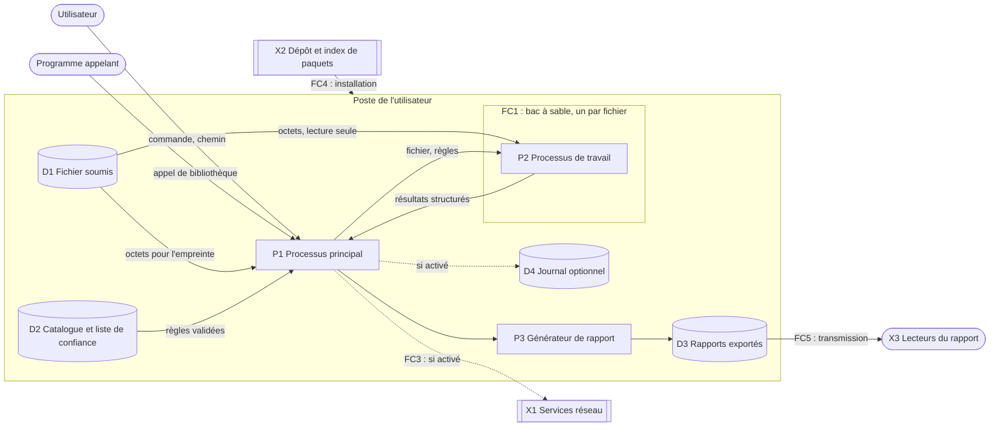

# Modèle de menace

> Statut : **v1.0, proposée à TheDarkMac dans la PR de T03**. Document vivant : toute modification est inscrite à l'historique (§12).
> Exigences : NF-15 (livrable 7 du §9), NF-01, NF-16, NF-18 ; constats A-14, A-16, A-31, A-37, A-42, A-48, A-53 de l'[analyse critique](../01-analyse/analyse-critique-cdc-v0.1.md).
> Tâche : T03. Date de rédaction : 2026-10-26.

## 1. Objet et méthode

Ce document décrit qui peut vouloir nuire au projet ou à ses utilisateurs, avec quels moyens, contre quels biens, par quelles surfaces, et ce que le projet fait en réponse. NF-15 impose de le rédiger **avant tout choix d'architecture** : il ne choisit ni langage ni bibliothèque (T04), mais fixe les **exigences de sécurité** (§8) que l'architecture devra satisfaire.

### Cadre : ce qui est déjà décidé

Le modèle s'applique à l'outil tel que T02 l'a défini :

- ligne de commande et bibliothèque, **traitement local**, **hors ligne par défaut**, aucun compte, aucun fichier conservé ([ADR-0010](../decisions/ADR-0010-distribution-et-traitement-local.md)) ;
- public prioritaire : journalistes et vérificateurs ([ADR-0009](../decisions/ADR-0009-public-cible.md)) ;
- règles, seuils et limites publics ([ADR-0019](../decisions/ADR-0019-publicite-des-regles.md)) ;
- services tiers à base d'IA optionnels, aucun en V1 ([ADR-0017](../decisions/ADR-0017-services-tiers-et-ocr.md)) ;
- exports HTML autonome et JSON, données identifiantes masquées par défaut ([ADR-0025](../decisions/ADR-0025-exports-et-accessibilite.md)) ;
- périmètre de la V1 ([ADR-0012](../decisions/ADR-0012-perimetre-v1.md)).

Un changement de ce cadre (serveur, interface web, nouveau format, nouvelle requête sortante) impose de réviser ce modèle (§11).

### Méthode

Fixée par [ADR-0027](../decisions/ADR-0027-methode-du-modele-de-menace.md) :

1. un **diagramme de flux de données** avec ses frontières de confiance (§5) ;
2. **STRIDE** appliqué à chaque élément du diagramme (§6) : usurpation (S), altération (T), répudiation (R), divulgation d'information (I), déni de service (D), élévation de privilège (E) ;
3. des **cas d'abus** pour ce que STRIDE ne couvre pas : l'outil fonctionne comme prévu, mais sert un but nuisible (§7) ;
4. une **cote qualitative** de chaque menace, avant mesures (grille ci-dessous) ;
5. des **exigences de sécurité** numérotées (ES-xx), rattachées aux tâches qui les réalisent (§8).

#### Grille de cotation

| Vraisemblance | Définition |
| --- | --- |
| Élevée | À la portée d'un adversaire du §3 avec des outils publics ; déjà observé sur des logiciels de même nature. |
| Moyenne | Demande une compétence particulière ou une condition favorable (option activée, dépendance vulnérable). |
| Faible | Demande des moyens importants ou une compromission préalable. |

| Gravité | Définition |
| --- | --- |
| Élevée | Compromission du poste, identification d'une source, ou faux présenté comme preuve. |
| Moyenne | Fuite limitée, analyse interrompue, constat faux présenté comme indice. |
| Faible | Gêne sans atteinte à un bien du §2. |

| Vraisemblance \ Gravité | Faible | Moyenne | Élevée |
| --- | --- | --- | --- |
| **Élevée** | Moyen | Haut | Haut |
| **Moyenne** | Bas | Moyen | Haut |
| **Faible** | Bas | Bas | Moyen |

La cote est donnée **avant** les mesures : elle dit où porter l'effort. Ce qui reste après les mesures est au §9.

## 2. Biens à protéger

| ID | Bien | Propriété à protéger | Pourquoi |
| --- | --- | --- | --- |
| B1 | Fichiers soumis | Confidentialité, intégrité | Documents reçus de sources, souvent inédits (NF-04, NF-15). L'outil ne les modifie jamais (§3 du cahier). |
| B2 | Identité des sources | Confidentialité | Bien désigné par NF-15. Elle peut se lire dans le fichier (métadonnées, nom, variantes propres à un destinataire) et dans **le seul fait** que l'utilisateur détient ce fichier. |
| B3 | Poste de l'utilisateur | Intégrité, confidentialité de ses autres données, disponibilité | L'outil y analyse des fichiers potentiellement piégés (NF-01). |
| B4 | Rapports | Intégrité, confidentialité | Ils circulent (CU-3) et peuvent contenir des données identifiantes révélées. |
| B5 | Catalogue de règles et liste de confiance C2PA | Intégrité | Un catalogue altéré peut blanchir des faux (A-37). |
| B6 | Code, dépendances et canal de distribution | Intégrité | Une version piégée de l'outil compromet B1 à B5 chez tous les utilisateurs. |
| B7 | Justesse des constats | Intégrité | Un constat faux, ou mal formulé, trompe le lecteur ; c'est la raison d'être de l'outil. |
| B8 | Activité de l'utilisateur | Confidentialité | Savoir qu'un journaliste examine tel fichier, à tel moment, renseigne sur une enquête en cours. |

## 3. Adversaires

| ID | Adversaire | Objectif | Moyens supposés |
| --- | --- | --- | --- |
| A1 | **Faussaire** | Faire passer un contenu généré ou retouché pour authentique ; ou l'inverse, faire passer un contenu authentique pour généré, afin de le discréditer. | Générateurs, outils d'édition de métadonnées, accès à l'outil et à ses règles publiques (ADR-0019). |
| A2 | **Attaquant technique** | Prendre le contrôle du poste au moyen d'un fichier piégé, ou le rendre inutilisable. | Fichiers malformés, exploitation de failles connues de bibliothèques de décodage, fuzzing. |
| A3 | **Chercheur de source** | Identifier la source d'un journaliste : organisation victime d'une fuite, employeur, État. | Détient souvent l'original ou ses variantes ; peut observer le réseau, recevoir des requêtes, saisir un poste, lire les rapports publiés. |
| A4 | **Utilisateur hostile aux sources** | Se servir de l'outil lui-même pour retrouver l'auteur d'une fuite (double usage, A-14). | L'outil, ses fonctions de comparaison, ses propres exemplaires du document. |
| A5 | **Attaquant de la chaîne d'approvisionnement** | Diffuser une version piégée de l'outil, d'une dépendance, du catalogue ou de la liste de confiance. | Typosquattage, compromission d'un compte de mainteneur ou d'une dépendance. |
| A6 | **Contrefacteur de rapport** | Produire ou modifier un rapport attribué à l'outil pour appuyer une affirmation. | Un éditeur de texte. |
| A7 | **Tiers curieux** | Exploiter ce qui leur parvient : service tiers, autorité de certification, autorité d'horodatage, observateur du réseau. | Ce que l'outil leur envoie. |

L'**utilisateur négligent** n'est pas un adversaire, mais ses erreurs (sur-interprétation, transmission d'un rapport démasqué) sont traitées comme des cas d'abus (§7).

## 4. Hypothèses et hors périmètre

| ID | Hypothèse | Conséquence si elle tombe |
| --- | --- | --- |
| H1 | Le poste n'est pas compromis avant l'installation, et son système est maintenu à jour. | Aucune mesure de l'outil ne tient sur un poste compromis (RR-05). |
| H2 | L'utilisateur obtient l'outil par le canal officiel documenté (T04). | Une version d'un autre canal peut être piégée (M-32). |
| H3 | L'utilisateur ne cherche pas à nuire à ses propres sources ; l'outil le protège de ses erreurs par des réglages sûrs par défaut, pas de ses choix délibérés. | Voir le cas d'abus C-03 pour un utilisateur hostile aux sources. |
| H4 | La protection du fichier avant et après l'analyse (canal de réception, stockage chiffré, effacement) relève de l'utilisateur. | Hors de portée de l'outil ; rappelé dans la documentation (T103). |
| H5 | Une session d'analyse sert un seul utilisateur. | Un usage multi-utilisateur (serveur) impose de réviser ce modèle. |

Hors périmètre de ce modèle : la sécurité physique, l'anonymat réseau de l'utilisateur, la protection contre un adversaire qui contrôle le noyau du système.

## 5. Diagramme de flux et frontières de confiance

Description textuelle du diagramme (accessibilité, ADR-0025) :

- L'utilisateur (ligne de commande) ou un programme appelant (bibliothèque) s'adresse au **processus principal P1**.
- P1 lit les octets du **fichier soumis D1** pour en calculer l'empreinte, sans les interpréter, et charge le **catalogue D2**.
- P1 confie chaque fichier à un **processus de travail P2**, isolé dans un bac à sable (frontière FC1), qui lit le fichier en lecture seule et renvoie des résultats structurés (frontière FC2, de P2 vers P1).
- Le **générateur de rapport P3** produit les exports D3, qui peuvent ensuite être transmis à des lecteurs (frontière FC5).
- Si l'utilisateur les active, P1 écrit un **journal D4** et interroge des **services réseau X1** (frontière FC3).
- L'outil, ses dépendances et son catalogue arrivent sur le poste depuis le **dépôt et l'index de paquets X2** (frontière FC4).

| Frontière | Entre | Ce qui la traverse | Ce qui est de confiance |
| --- | --- | --- | --- |
| FC1 | Fichier soumis → processus de travail | Octets hostiles | Rien : tout octet du fichier est hostile (NF-01). |
| FC2 | Processus de travail → processus principal | Résultats d'analyse | Rien : P2 peut avoir été compromis par le fichier. |
| FC3 | Poste → réseau | Requêtes sortantes (§6.3) | Les réponses sont vérifiées, jamais crues. |
| FC4 | Dépôt → poste | Code, dépendances, catalogue | Le canal officiel, sous H2. |
| FC5 | Poste → lecteurs | Rapports | Le rapport ne doit rien emporter que l'utilisateur n'a pas choisi de révéler. |

### Surface d'analyse de la V1

La V1 (ADR-0012) réduit déjà la surface : aucun décodage audio ni vidéo, seulement la lecture des conteneurs pour l'identification, les métadonnées et C2PA. Restent exposés, dans P2 :

- les analyseurs d'images (JPEG, PNG, WebP, HEIC) pour les métadonnées et les tables de quantification JPEG ;
- l'analyseur PDF (objets, flux compressés, révisions) ;
- les archives ZIP et le XML de DOCX et ODT, le XML de XMP ;
- les structures C2PA : JUMBF, CBOR, COSE et certificats X.509 (ASN.1), historiquement riches en failles ;
- les conteneurs audio et vidéo (balises seulement).

## 6. Menaces (STRIDE)

Colonnes : élément du §5 ; catégorie STRIDE ; adversaire (§3) ; biens (§2) ; vraisemblance (V) et gravité (G) ; cote ; mesures (exigences du §8).

### 6.1 Entrée du fichier et processus de travail (D1, P2, FC1)

| ID | Élément | STRIDE | Menace | Adv. | Biens | V | G | Cote | Mesures |
| --- | --- | --- | --- | --- | --- | --- | --- | --- | --- |
| M-01 | P2 | E | Exécution de code par une faille d'un analyseur ou d'un décodeur (dépassement de mémoire dans une bibliothèque écrite en C) | A2 | B1, B2, B3 | Moyenne | Élevée | Haut | ES-01, ES-02, ES-18, ES-19 |
| M-02 | P2 | D | Bombe de décompression (flux PDF, PNG, ZIP, entités XML imbriquées) ou dimensions déclarées gigantesques qui épuisent la mémoire | A2, A1 | B3 | Élevée | Moyenne | Haut | ES-03 |
| M-03 | P2 | D | Complexité algorithmique : références d'objets PDF circulaires, chaînes de révisions sans fin, expression régulière à retour arrière catastrophique sur une métadonnée | A2 | B3 | Élevée | Moyenne | Haut | ES-03, ES-09 |
| M-04 | P2 | I, E | Entité externe XML (XMP, DOCX, ODT) qui lit un fichier local ou déclenche une requête réseau | A2, A3 | B1, B3, B8 | Moyenne | Élevée | Haut | ES-02, ES-05 |
| M-05 | P2 | T | Écriture hors du répertoire prévu lors de l'extraction d'une archive (DOCX, ODT), ou modification du fichier soumis | A2 | B1, B3 | Moyenne | Élevée | Haut | ES-02, ES-05 |
| M-06 | D1 | T | Le fichier change entre le calcul de l'empreinte et l'analyse (partage réseau, lien symbolique remplacé) : le rapport décrit un autre contenu que celui qu'il identifie | A2 | B7 | Faible | Moyenne | Bas | ES-08 |
| M-07 | P2 | E | Exécution d'un contenu actif : JavaScript ou action automatique PDF, macro bureautique, lien | A2 | B3 | Faible | Élevée | Moyen | ES-06 |
| M-08 | P2 | S | Fichier polyglotte (valide dans deux formats) ou discordance d'extension pour viser un analyseur précis ou échapper à un contrôle (A-31) | A1, A2 | B3, B7 | Moyenne | Moyenne | Moyen | ES-07 |
| M-09 | P2 | D | Dans un lot (ADR-0015), un fichier hostile fait échouer ou altère les rapports des autres | A2 | B3, B7 | Moyenne | Moyenne | Moyen | ES-01, ES-04 |
| M-10 | FC2 | T, E | Un processus de travail compromis renvoie des résultats malformés pour attaquer P1 (désérialisation), ou forgés pour falsifier le rapport | A2 | B3, B7 | Faible | Élevée | Moyen | ES-04 ; reste RR-01 |

### 6.2 Catalogue et liste de confiance (D2)

| ID | Élément | STRIDE | Menace | Adv. | Biens | V | G | Cote | Mesures |
| --- | --- | --- | --- | --- | --- | --- | --- | --- | --- |
| M-11 | D2 | T | Catalogue ou liste de confiance altérés (paquet piégé, modification locale) pour blanchir des faux ou faire reconnaître un signataire | A5, A1 | B5, B7 | Faible | Élevée | Moyen | ES-09, ES-18 |
| M-12 | D2 | D | Catalogue malformé (règle invalide, expression régulière catastrophique) qui fait échouer l'analyse | A5 | B3 | Faible | Moyenne | Bas | ES-09 |
| M-13 | D2 | S | Liste de confiance périmée hors ligne : un certificat révoqué depuis sa livraison est tenu pour valide | A1 | B7 | Moyenne | Moyenne | Moyen | ES-09, ES-10 ; reste RR-09 |

### 6.3 Requêtes sortantes (X1, FC3)

| ID | Élément | STRIDE | Menace | Adv. | Biens | V | G | Cote | Mesures |
| --- | --- | --- | --- | --- | --- | --- | --- | --- | --- |
| M-14 | X1 | I | Balise de pistage : une URL posée dans le fichier (manifeste C2PA distant, modèle distant d'un DOCX, lien XMP) est résolue, et révèle à l'auteur du fichier l'adresse, l'heure et l'exemplaire analysé | A3 | B2, B8 | Élevée | Élevée | Haut | ES-06, ES-10 |
| M-15 | X1 | I | Fichier envoyé à un service tiers (ADR-0017) : fuite du contenu, conservation, réutilisation | A7 | B1, B2 | Moyenne | Élevée | Haut | ES-10 |
| M-16 | X1 | I | Une requête de révocation (OCSP) révèle à l'autorité de certification et au réseau quel certificat est vérifié, et quand | A7, A3 | B8 | Faible | Moyenne | Bas | ES-10 |
| M-17 | X1 | I | Une requête d'horodatage révèle l'heure d'activité et l'adresse de l'utilisateur | A7 | B8 | Faible | Faible | Bas | ES-16 |
| M-18 | X1 | S, T | Réponse réseau falsifiée : fausse réponse de révocation, faux manifeste distant | A1 | B7 | Faible | Moyenne | Bas | ES-10 |
| M-19 | P2, P1 | I | Requête non inventoriée introduite par une dépendance (télémétrie, schéma XML ou police téléchargés) | A5, A7 | B1, B8 | Moyenne | Élevée | Haut | ES-02, ES-11, ES-18 |

#### Inventaire des requêtes sortantes (NF-16)

C'est l'inventaire initial exigé par NF-16 ; il est tenu à jour à chaque tâche qui ajoute une requête, et vérifié par ES-11. Politique : [ADR-0033](../decisions/ADR-0033-politique-des-requetes-sortantes.md).

| ID | Requête | Données envoyées | Destinataire | Ce qu'elle révèle | Par défaut | Tâche |
| --- | --- | --- | --- | --- | --- | --- |
| RS-01 | Révocation des certificats C2PA (CRL de préférence, OCSP sinon) | CRL : rien de propre au fichier. OCSP : émetteur et numéro de série du certificat | Autorité de certification du signataire | OCSP : qu'un certificat donné est vérifié, et quand | Désactivée | T30 |
| RS-02 | Manifeste C2PA distant | L'URL écrite dans le fichier | Hôte choisi par l'auteur du fichier | Adresse, heure, et l'exemplaire si l'URL lui est propre | Désactivée ; confirmation par fichier | T30 |
| RS-03 | Horodatage RFC 3161 du rapport | Empreinte du rapport | Autorité d'horodatage choisie par l'utilisateur | Adresse et heure | Désactivée | T91 |
| RS-04 | Service tiers à base d'IA | En général le fichier | Fournisseur du service | Contenu du fichier | Aucun en V1 ; consentement par fichier | Point d'extension (T04) |
| RS-05 | Références bibliographiques (F-72) | Références citées | Bases publiques | Contenu du travail (A-42) | Hors V1 (ADR-0013) | T83 |

La mise à jour de l'outil, de son catalogue et de sa liste de confiance n'est pas une requête de l'outil : elle passe par le gestionnaire de paquets de l'utilisateur ([ADR-0029](../decisions/ADR-0029-integrite-du-catalogue.md)).

### 6.4 Rapport et sorties (P3, D3, FC5)

| ID | Élément | STRIDE | Menace | Adv. | Biens | V | G | Cote | Mesures |
| --- | --- | --- | --- | --- | --- | --- | --- | --- | --- |
| M-20 | P3 | E, I | Injection dans le rapport HTML (script, ressource externe) par une chaîne tirée du fichier : exécution à l'ouverture, balise de pistage, exfiltration | A2, A3 | B3, B4, B8 | Élevée | Élevée | Haut | ES-12 |
| M-21 | P3 | S, T | Caractères de contrôle ou bidirectionnels dans une valeur affichée : séquences d'échappement du terminal, texte inversé qui fait lire autre chose que la donnée réelle | A1, A2 | B3, B7 | Moyenne | Moyenne | Moyen | ES-12 |
| M-22 | D3 | I | Fuite des données identifiantes par un rapport transmis : GPS, numéro de série, auteur, nom du fichier, **empreinte** (A-48) | A3 | B2 | Élevée | Élevée | Haut | ES-13 |
| M-23 | D3 | I | Le rapport renseigne sur l'utilisateur ou la source sans rien en dire : chemin absolu (nom de dossier, nom d'utilisateur), nom de machine, fuseau horaire | A3 | B2, B8 | Élevée | Moyenne | Haut | ES-14 |
| M-24 | D3 | S, T | Rapport contrefait ou modifié, attribué à l'outil | A6 | B4, B7 | Moyenne | Moyenne | Moyen | ES-16 ; reste RR-06 |
| M-25 | D3 | R | Contestation de la date d'une analyse (NF-17) | A6 | B4 | Moyenne | Faible | Bas | ES-16 |

### 6.5 Poste et système de fichiers (P1, D4)

| ID | Élément | STRIDE | Menace | Adv. | Biens | V | G | Cote | Mesures |
| --- | --- | --- | --- | --- | --- | --- | --- | --- | --- |
| M-26 | P1, P2 | I | Rémanence : fichiers temporaires, caches, vignettes, journaux de débogage, messages d'erreur ou vidages mémoire qui contiennent le contenu ou le nom du fichier, retrouvés lors d'une saisie | A3 | B1, B2 | Moyenne | Élevée | Haut | ES-15 |
| M-27 | D4 | I | Le journal de conservation révèle, lors d'une saisie, quels fichiers l'utilisateur a examinés ; une empreinte y suffit à qui détient l'original | A3 | B2, B8 | Moyenne | Élevée | Haut | ES-16 |
| M-28 | D4 | T | Falsification du journal local par l'utilisateur ou par un tiers | A6 | B4 | Moyenne | Faible | Bas | ES-16 |

### 6.6 Interface de bibliothèque (P1)

| ID | Élément | STRIDE | Menace | Adv. | Biens | V | G | Cote | Mesures |
| --- | --- | --- | --- | --- | --- | --- | --- | --- | --- |
| M-29 | P1 | E | Le programme appelant analyse un fichier hostile **dans son propre processus**, hors de tout bac à sable (A-16) | A2 | B3 | Élevée | Élevée | Haut | ES-17 |
| M-30 | P1 | D | Chemin fourni vers un fichier spécial (périphérique, tube nommé) : lecture sans fin, blocage | A2 | B3 | Moyenne | Moyenne | Moyen | ES-08 |

### 6.7 Chaîne d'approvisionnement (X2, FC4)

| ID | Élément | STRIDE | Menace | Adv. | Biens | V | G | Cote | Mesures |
| --- | --- | --- | --- | --- | --- | --- | --- | --- | --- |
| M-31 | X2 | T, E | Dépendance compromise ou typosquattée, compte de mainteneur compromis, action d'intégration continue piégée | A5 | B1 à B6 | Moyenne | Élevée | Haut | ES-18 |
| M-32 | X2 | S | Faux outil distribué sous le nom du projet, par un autre canal | A5 | B1 à B6 | Faible | Élevée | Moyen | ES-18 |
| M-33 | Corpus | T | Corpus de calibrage empoisonné, pour régler un seuil qui laisse passer une famille de faux (ADR-0016) | A1 | B7 | Faible | Moyenne | Bas | ES-22 |

## 7. Cas d'abus

Dans ces cas, l'outil fonctionne comme prévu ; c'est l'usage ou l'interprétation qui nuit.

| ID | Cas | Adv. | Biens | V | G | Cote | Réponse |
| --- | --- | --- | --- | --- | --- | --- | --- |
| C-01 | **Oracle du faussaire** : le faussaire passe ses fichiers dans l'outil jusqu'à obtenir un rapport sans indice. Les règles étant publiques (ADR-0019), il sait quoi effacer. | A1 | B7 | Élevée | Moyenne | Haut | Risque accepté par ADR-0019 (RR-03). L'absence de constat n'est jamais présentée comme une authenticité (principe « absence ≠ authenticité », F-14) ; la couverture borne la portée du résultat (F-25, F-82). |
| C-02 | **Discrédit d'un contenu authentique** (« dividende du menteur ») : le faussaire ajoute à un vrai contenu une déclaration d'IA (IPTC `trainedAlgorithmicMedia`, manifeste C2PA hors liste de confiance, filigrane usurpé) pour le faire passer pour généré. | A1 | B7 | Élevée | Élevée | Haut | ES-20 : une déclaration non signée est restituée comme ce que le fichier **déclare**, jamais comme un fait ; une signature hors liste de confiance est un indice (ADR-0021). La documentation utilisateur explique ce cas (T103). |
| C-03 | **Identification de la source par double usage** (A-14) : l'organisation victime d'une fuite compare des exemplaires (F-91), décode des points de traçage (F-90) ou relie une photo à un appareil (F-35). | A4 | B2 | Moyenne | Élevée | Haut | ES-21 : garde-fous d'[ADR-0032](../decisions/ADR-0032-double-usage.md). Ces fonctions sont hors V1. |
| C-04 | **Accusation fondée sur le rapport** : un indice est lu comme une preuve, un faux positif fonde une accusation de fraude. | Utilisateur négligent | B7 | Moyenne | Élevée | Haut | Aucun score ni verdict (ADR-0018) ; niveau et taux d'erreur de chaque règle au rapport ; mentions d'avertissement (T103). |
| C-05 | **Démasquage puis transmission** : l'utilisateur lève le masquage des données identifiantes et transmet le rapport sans s'en rendre compte. | Utilisateur négligent | B2 | Moyenne | Élevée | Haut | ES-13 : la levée est explicite, et un rapport démasqué l'annonce en tête. Reste RR-08. |

## 8. Exigences de sécurité

Chaque exigence dérive des menaces citées ; T04 choisit les moyens, les tâches citées les réalisent. Une exigence de sécurité est vérifiée comme une exigence du cahier (ADR-0024), dans la matrice de T17.

| ID | Exigence | Menaces | Décision | Tâches |
| --- | --- | --- | --- | --- |
| ES-01 | Chaque fichier est analysé dans **un processus de travail qui lui est propre**. Le processus principal ne fait que lire les octets pour l'empreinte, sans les interpréter. | M-01, M-09 | ADR-0028 | T04, T12, T14 |
| ES-02 | Le processus de travail n'a **aucun accès réseau**, lit le fichier en lecture seule, n'écrit nulle part ailleurs qu'un éventuel répertoire temporaire privé, et tourne avec les privilèges les plus réduits que le système permet. Si le système ne permet pas tout, le rapport porte « isolation réduite » et dit ce qui manque. | M-01, M-04, M-05, M-19 | ADR-0028 | T04, T14 |
| ES-03 | Limites de ressources : taille d'entrée, taille décompressée cumulée et rapport de compression, dimensions déclarées, profondeur d'imbrication, nombre d'objets, mémoire, temps ou budget de travail (ADR-0023). Dépassement : analyse interrompue, signalée au rapport (NF-02, NF-08). Valeurs fixées en T14. | M-02, M-03 | ADR-0028 | T14 |
| ES-04 | Le processus de travail renvoie des données simples (pas d'objets sérialisés), de taille bornée, **validées par un schéma** dans le processus principal ; un résultat invalide devient une analyse non menée. Aucun état partagé entre les fichiers d'un lot. | M-09, M-10 | ADR-0028 | T11, T12 |
| ES-05 | XML lu sans DTD, sans entités externes ni résolution réseau. Archives lues en mémoire, jamais extraites sur disque, avec les limites d'ES-03. | M-04, M-05 | — | T04, T20, T21 |
| ES-06 | Aucun contenu actif exécuté, aucune page rendue, **aucune URL issue du fichier résolue automatiquement** (RS-02 excepté, sur confirmation, ES-10). | M-07, M-14 | ADR-0033 | T21, T30, T52 |
| ES-07 | Identification du format par le contenu (F-02) ; un fichier reconnu dans plusieurs formats, ou qui contient des données après sa fin logique, est signalé comme tel ; chaque format reconnu est analysé, ou déclaré non analysé avec la raison. | M-08 | — | T13 |
| ES-08 | Seuls les fichiers réguliers sont acceptés ; le processus de travail recalcule l'empreinte de ce qu'il a analysé, et un écart avec celle de P1 invalide le rapport. | M-06, M-30 | — | T13 |
| ES-09 | Catalogue et liste de confiance livrés avec l'outil, **validés par schéma au chargement**, version et empreinte inscrites au rapport ; un catalogue fourni par l'utilisateur est signalé comme tel. Les expressions régulières du catalogue sont à temps linéaire. | M-03, M-11, M-12, M-13 | ADR-0029 | T15, T30 |
| ES-10 | Requêtes sortantes : inventaire du §6.3 tenu à jour ; toutes désactivées par défaut ; état de chacune au rapport ; aucune n'emporte le fichier, son contenu ni ses données identifiantes, sauf service tiers consenti pour ce fichier ; manifeste distant sur confirmation par fichier, hôte affiché ; CRL préférées à OCSP ; TLS vérifié ; réponses vérifiées puis inscrites au rapport. Sans vérification de révocation, le rapport le dit. | M-13 à M-16, M-18 | ADR-0010, ADR-0017, ADR-0033 | T04, T30 |
| ES-11 | Le banc d'évaluation exécute l'analyse **sans réseau** et échoue à toute tentative de connexion (A-52). | M-19 | — | T17 |
| ES-12 | Rapport HTML : tout texte issu du fichier est échappé ; politique de sécurité du contenu interdisant toute ressource externe et tout script non prévu par l'outil ; aucune ressource externe (ADR-0025). Toute sortie (HTML, JSON, terminal) neutralise les caractères de contrôle et bidirectionnels, en les montrant sous forme visible. | M-20, M-21 | — | T16, T90 |
| ES-13 | Données identifiantes masquées par défaut dans **tous** les exports et la sortie du terminal : métadonnées nominatives, numéros de série, GPS, nom du fichier (ADR-0014) et **empreinte** (ADR-0031). Levée explicite, par catégorie ; un rapport démasqué l'annonce en tête. | M-22, C-05 | ADR-0031 | T16 |
| ES-14 | Le rapport n'inscrit ni chemin, ni nom de machine, ni utilisateur du système ; les heures sont en UTC. | M-23 | — | T16 |
| ES-15 | **Aucune trace par défaut** : ni cache, ni journal, ni télémétrie ; fichiers temporaires dans un répertoire privé effacé en fin d'analyse, ou en mémoire ; messages d'erreur sans contenu du fichier ni chemin ; vidages mémoire désactivés pour le processus de travail. | M-26 | ADR-0030 | T14, T91 |
| ES-16 | NF-17 en local : journal optionnel, chaîné, sans noms de fichier, avec avertissement à l'activation ; « qui » déclaratif ; horodatage RFC 3161 optionnel de l'empreinte du rapport ; heure du poste toujours inscrite, marquée « non certifiée ». | M-17, M-24, M-25, M-27, M-28 | ADR-0030 | T91 |
| ES-17 | La bibliothèque n'expose **aucune fonction qui analyse dans le processus appelant** ; toute analyse passe par ES-01. | M-29 | ADR-0028 | T04, T12 |
| ES-18 | Chaîne d'approvisionnement : dépendances en nombre minimal, versions figées avec empreintes (ADR-0023) ; préférence, à fonction égale, pour les analyseurs écrits dans un langage sûr pour la mémoire ; actions d'intégration continue épinglées par empreinte de commit (déjà le cas, ADR-0006) ; canal de distribution unique documenté, empreintes des versions publiées. | M-01, M-11, M-19, M-31, M-32 | — | T04, T10 |
| ES-19 | Fuzzing des analyseurs de chaque format de la V1 ; catégorie « malformés » du corpus (§8 du cahier). | M-01 à M-05 | — | T14, T100, T102 |
| ES-20 | Une déclaration non signée est restituée comme ce que le fichier déclare ; seule une vérification cryptographique ou déterministe produit une preuve (ADR-0021). | C-02 | ADR-0021 | T11, T22, T30 |
| ES-21 | Fonctions à double usage (T45, T93, T94) soumises aux garde-fous d'ADR-0032. | C-03 | ADR-0032 | T45, T93, T94 |
| ES-22 | Provenance documentée de chaque fichier du corpus ; corpus versionné ; calibrage reproductible. | M-33 | ADR-0016 | T100 |

Les exigences sans ADR découlent directement d'une exigence du cahier (NF-01, NF-02, NF-16, NF-18, F-02) ou d'une décision déjà prise ; elles ne choisissent pas entre des options.

## 9. Risques résiduels

Ce qui reste après les mesures, et pourquoi c'est accepté.

| ID | Risque | Pourquoi il reste | Traitement |
| --- | --- | --- | --- |
| RR-01 | Un processus de travail compromis forge un constat, y compris une « signature valide », dans le rapport du fichier qui l'a compromis. | Revérifier les preuves hors du bac à sable exposerait P1 aux mêmes analyseurs. | La compromission reste confinée à ce fichier (ES-01, ES-04) ; reproductibilité : une autre machine peut refaire l'analyse. |
| RR-02 | Évasion du bac à sable par une faille du système. | Hors de portée d'un outil applicatif. | Documentation (T103) : conteneur ou machine virtuelle pour les profils exposés. |
| RR-03 | Oracle du faussaire (C-01). | Conséquence assumée d'ADR-0019. | Limites connues publiées (T102). |
| RR-04 | Contenu généré sans marquage, ou dont les marques ont été retirées (A-04). | Hors de portée de toute analyse déclarative. | Mentions (T103) : l'outil reconnaît les contenus déclarés, il ne garantit rien contre un faussaire qui retire les marques. |
| RR-05 | Poste compromis (H1). | Aucune mesure applicative ne tient. | Documentation (T103). |
| RR-06 | Rapport contrefait en l'absence d'horodatage. | Une signature par une clé locale ne prouverait rien de plus. | Réanalyse du fichier avec les mêmes versions (ADR-0023) ; horodatage optionnel. |
| RR-07 | Double usage résiduel : le code est libre, un tiers peut ajouter ce que le projet s'interdit (ADR-0032). | Licence Apache-2.0 (ADR-0011). | Le projet ne le livre pas ; les fiches décrivent le double usage. |
| RR-08 | Rapport démasqué transmis par l'utilisateur (C-05). | Choix de l'utilisateur (H3). | Annonce en tête du rapport (ES-13). |
| RR-09 | Révocation inconnue hors ligne (M-13). | Hors ligne par défaut (ADR-0010). | Date de la liste de confiance et absence de vérification de révocation inscrites au rapport. |

## 10. Réponses aux points renvoyés à T03

| Origine | Question | Réponse |
| --- | --- | --- |
| A-14, ADR-0014 | Double usage de F-35, F-90, F-91 | C-03, [ADR-0032](../decisions/ADR-0032-double-usage.md) |
| A-16, ADR-0010 | NF-01 et NF-17 en mode local | [ADR-0028](../decisions/ADR-0028-niveau-d-isolation.md), [ADR-0030](../decisions/ADR-0030-portee-de-nf-17-en-local.md) |
| A-31 | Fichiers polyglottes | M-08, ES-07 |
| A-37, registre §3 point 9 | Authentification du catalogue | [ADR-0029](../decisions/ADR-0029-integrite-du-catalogue.md) ; format en T15 |
| A-42 | Requêtes emportant le contenu | NF-16 étendue au contenu ([ADR-0033](../decisions/ADR-0033-politique-des-requetes-sortantes.md)) ; F-72 hors V1 (ADR-0013) |
| A-48 | Nom et empreinte dans le rapport | [ADR-0031](../decisions/ADR-0031-empreinte-donnee-identifiante.md) |
| A-53, registre §3 point 10 | Niveau d'isolation | ADR-0028 ; mécanismes en T04 |
| ADR-0017 | Flux vers les services tiers | M-15, RS-04, ES-10 |

## 11. Révision du modèle

Le modèle est révisé, avec une nouvelle version et une ligne d'historique :

- quand un format, une technique ou une requête sortante est ajouté ;
- quand le cadre du §1 change (interface web locale, serveur, analyse groupée) ;
- après les travaux de l'équipe rouge (T102) ;
- avant toute publication d'une version de l'outil.

Chaque tâche qui touche une surface du §5 vérifie, dans sa PR, que ses menaces y figurent.

## 12. Historique

| Date | Version | Modification | Origine |
| --- | --- | --- | --- |
| 2026-10-26 | 1.0 | Création | T03 |
